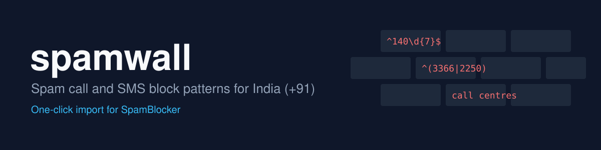

# SpamWall

**For Indian phone numbers (+91), calls and SMS.** SpamWall is a set of pattern-based block rules you can import in one click. It is built for [SpamBlocker](https://github.com/aj3423/SpamBlocker) on Android; the plain regex lists work in any blocker that accepts regular expressions.

It blocks whole number ranges used by telemarketers and call centres instead of single numbers. Every rule filters both calls and SMS. Calls and messages from shopping, delivery, ride and payment apps, from your contacts, and from official service lines are never blocked.

> SMS filtering works only when **SMS** is switched on under *Settings > Screening* in SpamBlocker; follow the setup prompt it shows.
## The app: SpamBlocker

SpamWall's import files are made for **[SpamBlocker](https://github.com/aj3423/SpamBlocker)**, a free, open-source call and SMS blocker for Android by aj3423. It is the app the maintainer uses every day with these rules.

- Get it from [F-Droid](https://f-droid.org/packages/spam.blocker/) or the [GitHub releases page](https://github.com/aj3423/SpamBlocker/releases).
- It runs on your phone with no account, and number checks happen on the device.
- Questions about the app itself go to the [SpamBlocker repository](https://github.com/aj3423/SpamBlocker/issues); questions about these rules go [here](../../issues).

SpamWall is a separate community project and is not made by or affiliated with SpamBlocker.

## Quick start (SpamBlocker)

1. Export a backup first (**Settings > Backup > Export**), because an import replaces your number rules.
2. Download [`spamblocker/complete.gz`](spamblocker/complete.gz), then **Settings > Backup > Import** and pick it.
3. Follow the full guide, including the manual steps the import cannot do: [docs/IMPORT.md](docs/IMPORT.md).

## Files

| File | What it has |
|---|---|
| [`spamblocker/settings.gz`](spamblocker/settings.gz) | Only the Others category (contacts, STIR, repeated call, dialed, answered, Recent Apps) |
| [`spamblocker/rules-default.gz`](spamblocker/rules-default.gz) | Only the Regex Settings category: allow rules and default block rules |
| [`spamblocker/rules-strict.gz`](spamblocker/rules-strict.gz) | `rules-default` plus IN-1600 (bank and government service calls) |
| [`spamblocker/complete.gz`](spamblocker/complete.gz) | `settings` plus `rules-default`, for a one-tap full setup |
| [`spamblocker/types/<ID>.gz`](spamblocker/types/) | One block pattern plus the allow rules (Regex Settings only), for blocking just one kind of call |
| [`rules/in/`](rules/in/) | One file per pattern in `allow/`, `block/` and `optional/`, plus [`allow-apps.txt`](rules/in/allow-apps.txt) |
| [`rules/in/patterns.md`](rules/in/patterns.md) | Table of every pattern, generated from the files |

Each `.gz` has a readable `.json` twin.

**What can be combined:** `settings` + any ONE rules file (`rules-default`, `rules-strict` or one `types/` file) is fine. Two rules files do not stack: the second replaces the first, and also deletes your own number rules. `complete` already has settings and default rules.

**Short version of the caveats:** settings never touch number rules; rules never touch settings. Importing `settings.gz` replaces your Recent Apps list and allow switches. Export a backup first, it is your undo. Not tested on every phone and SpamBlocker version, so report problems as issues. Details: [docs/IMPORT.md](docs/IMPORT.md).

**Releases:** download the files from the [latest release](../../releases/latest).

## How the rules are checked

SpamBlocker checks higher priorities first. Allow and block rules never share a priority.

| Priority | Type | Rules |
|---|---|---|
| 15 | Allow | `rules/in/allow/` (official delivery series, known support numbers) |
| 10 | Allow | Contacts, repeated calls, numbers you dialled or answered, Recent Apps (built into SpamBlocker) |
| 5 | Block | `rules/in/block/` |

## India rules

Numbers are matched without `+91` or a leading `0`.

### Allowed

| ID | Pattern | What it is | Source |
|---|---|---|---|
| IN-1601 | `^1601\d{6}$` | Official series for service and transactional calls from utilities, courier and logistics companies (your deliveries) | [TRAI Direction, 10 Aug 2026](https://trai.gov.in/sites/default/files/2026-08/Direction_10082026.pdf) |
| IN-AMAZON | `^2263257863$` | Amazon India customer service | Public number |

### Blocked by default

| ID | Pattern | What it blocks | Source |
|---|---|---|---|
| IN-140 | `^140\d{7}$` | Promotional and telemarketing calls. This series is for promotions only, so no real service call uses it | [TRAI TCCCPR 2018](https://trai.gov.in/release-publication/directions), [RBI circular, Jan 2025](https://www.rbi.org.in/scripts/NotificationUser.aspx?Id=12770) |
| IN-CC-LANDLINE | `^(1725\|2250\|2269\|3366\|3368\|3371\|4071\|7935\|7969\|7971)\d{6}$` | Call-centre landline ranges in Chandigarh (0172-5), Mumbai (022-50, 022-69), Kolkata (033-66, 033-68, 033-71), Hyderabad (040-71) and Ahmedabad (079-35, 079-69, 079-71) | Clustered from community spam reports |
| IN-CC-BLR | `^(803710\|...)\d{4}$` | Narrow Bengaluru call-centre blocks. Bengaluru `080` numbers are not blocked as a whole, because delivery apps call from them | Clustered from community spam reports |
| IN-BULK-MOBILE | `^(657350\|...)\d{4}$` | Mobile number blocks used for bulk telemarketing | Clustered from community spam reports |

### Optional (`rules-strict` only)

| ID | Pattern | What it blocks | Why it is off by default |
|---|---|---|---|
| IN-1600 | `^1600\d{6}$` | Service and transactional calls from banks, insurers, brokers, mutual funds and government | This is the **official** series that regulated entities must use ([TRAI, PIB](https://pib.gov.in/PressReleasePage.aspx?PRID=2191647)). Blocking it also blocks your real bank. |

**Credit card and loan spam:** promotions must come from the 140 series, which is blocked. Official bank calls must come from 1600, which stays allowed in the default file. A loan or credit-card pitch from an ordinary mobile or landline breaks TRAI rules; report it in the **Report Spam** app (TRAI DND) and open a *New spam pattern* issue here.

## Blocked by mistake?

Open an [**Unblock request**](../../issues/new?template=unblock-request.yml). Give the number (or its first digits), the company and why it is legitimate. If a rule blocks a real business, we narrow it or remove it.

## Contributing

See [CONTRIBUTING.md](CONTRIBUTING.md). Edit the files in `rules/<country>/allow/`, `block/` and `optional/`, then run `python -I tools/build_spamblocker.py` to rebuild the import files.

## License

MIT. This project is not affiliated with SpamBlocker, TRAI or any telecom operator.
